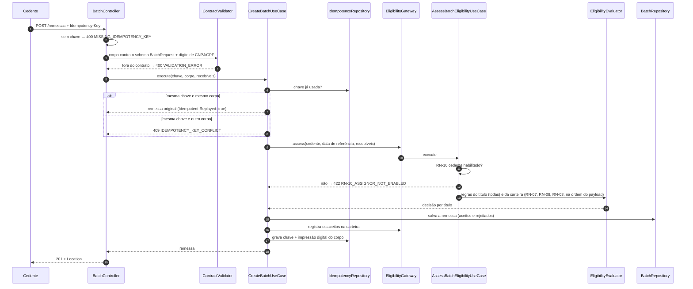

# API de remessa de recebíveis

Mock da API que recebe remessas de recebíveis, aplica as regras de elegibilidade RN-01 a RN-10 ([`docs/discovery/regras.md`](../docs/discovery/regras.md)) e expõe o resultado por título. O contrato é [`openapi.yaml`](openapi.yaml); a referência publicada está em [site/api.html](https://ccpnexatech.github.io/fidc-onboarding-cedente/site/api.html).

| Endpoint | Função |
|---|---|
| `POST /remessas` | Recebe a remessa. Exige `Idempotency-Key`. Responde `201` com a decisão por título, `400` para payload fora do contrato, `409` para conflito de idempotência e `422` para cedente não habilitado. |
| `GET /remessas/{id}` | Consulta a remessa e os totais. |
| `GET /remessas/{id}/rejeicoes` | Lista os títulos rejeitados e os códigos das regras violadas. |

Stack: NestJS 11, TypeScript e Ajv, com PostgreSQL opcional ([ADR-0002](../decisoes/0002-stack-do-mock.md)).

## Execução

```bash
make setup        # instala as dependências e sobe o PostgreSQL com o schema aplicado
make api          # compila e sobe o mock em http://localhost:3000 (Swagger em /docs)
make newman       # executa a coleção de homologação contra um mock recém-iniciado
make conciliacao  # executa o SQL de conciliação no PostgreSQL
make check        # estrutura, ESLint, tipos, camadas, testes e lint do OpenAPI
```

## Configuração

| Variável | Padrão | Uso |
|---|---|---|
| `PORT` | `3000` | Porta HTTP. |
| `REFERENCE_DATE` | `2026-10-14` | Data de referência da cessão. É fixa por padrão para que os testes sejam reproduzíveis. `today` usa a data corrente em São Paulo. |
| `FUND_NET_ASSET_VALUE` | `5000000000` | PL de referência, em centavos (R$ 50 milhões). |
| `CDI_ANNUAL_RATE_BASIS_POINTS` | `1490` | CDI de referência (14,90% a.a.). |
| `BATCH_REPOSITORY` | `memory` | `postgres` grava remessas e chaves de idempotência no PostgreSQL ([`sql/schema.sql`](sql/schema.sql)). |
| `DATABASE_URL` | — | Conexão com o PostgreSQL. Quando definida, os testes de integração também rodam contra o banco. |

## Arquitetura

```
src/
├── shared/        kernel: data de calendário, CNPJ/CPF, relógio, exceção de domínio; filtro problem+json e validação pelo contrato
├── eligibility/   regras RN-01 a RN-10, carteira simulada e calendário de dias úteis
│   ├── domain/            entidades, regras, avaliador, portas (repositórios) e use cases
│   └── infrastructure/    repositórios em memória, seed da carteira, feriados, parâmetros do fundo
└── batch/         remessa: envio, idempotência e consultas
    ├── domain/            entidade Batch, portas (repositórios, EligibilityGateway) e use cases
    └── infrastructure/    controller HTTP, repositórios em memória, adaptador para o módulo eligibility
```

- `domain/` não importa `infrastructure/`, framework nem o `domain` de outro módulo. O dependency-cruiser bloqueia a violação no `make check`.
- A composição fica nos `*.module.ts`. O controller recebe os use cases prontos.
- O módulo `batch` fala com `eligibility` pela porta `EligibilityGateway` (`batch/domain/service`). O adaptador fica em `batch/infrastructure/service`.
- O corpo de `POST /remessas` é validado contra o schema `BatchRequest` do próprio `openapi.yaml` (Ajv), mais o dígito verificador de CNPJ e CPF. Mudar o payload exige mudar o contrato primeiro.
- Cada regra `RN-NN` é aplicada em um único ponto, marcado com `// RN-NN · <fonte>` (ADR-0003).

## Carteira simulada

A carteira inicial fica em `src/eligibility/infrastructure/seed/portfolio-seed.json`. Ela é gerada por `scripts/generate-portfolio-seed.py`, que usa o mesmo calendário de dias úteis do mock. Na data de referência 2026-10-14:

| Item | Valor | Usado em |
|---|---|---|
| Carteira a vencer | R$ 35.000.000,00, prazo médio de cerca de 74 dias úteis | RN-03 (HU-08) |
| Cedente `12345678000195` (Alfa) | ativo, R$ 300.000,00 na carteira, título `DM-2026-0001` | cedente padrão dos testes; RN-09 (HU-07) |
| Cedente `11222333000181` (Beta) | ativo, R$ 3.700.000,00 na carteira | RN-08 (HU-06) |
| Cedente `98765432000198` (Gama) | suspenso | RN-10 (HU-01) |
| Cedente `77888999000181` (Delta) | em análise | RN-10 |
| Sacado `55666777000181` e filial `55666777000262` | R$ 1.950.000,00 no grupo | RN-07 (HU-06) |
| Sacado `44555666000181` | R$ 1.000.000,00 | RN-07 (HU-06) |
| Sacado `22333444000181` | título vencido há 10 dias | RN-05 (HU-04) |
| Sacado `33444555000181` | título vencido há 20 dias | RN-05 (HU-04) |

Os títulos aceitos entram na carteira em memória, e as remessas seguintes no mesmo processo consideram a nova exposição. Reiniciar o mock restaura a carteira inicial.

## Testes

- **Unit** (`src/**/*.spec.ts`): use cases e regras isolados, com as portas mockadas; um teste por cenário Gherkin.
- **Integration** (`test/*.spec.ts`): a aplicação Nest inteira, sem mocks, via HTTP (supertest). Usa os repositórios em memória e, com `DATABASE_URL` definida, também o Postgres, incluindo a conciliação de ponta a ponta.
- **Homologação** (`postman/`): coleção Postman com 29 casos, rodada pelo Newman no CI.
- **SQL** (`sql/`): relatório de conciliação comparado com a saída esperada.

## Fluxo de `POST /remessas`



## Melhorias propostas

Simplificações do mock e o tratamento esperado em produção, em ordem de risco para o fundo:

| # | Melhoria | Por que importa | Onde entra |
|---|---|---|---|
| M-01 | **Concorrência na carteira.** A exposição é lida, avaliada e gravada sem trava. Duas remessas simultâneas do mesmo sacado podem, juntas, ultrapassar o limite de 4%. | Desenquadramento silencioso (F-02). | Reserva de limite com transação serializável ou fila por sacado/cedente. |
| M-02 | **Autenticação e autorização.** O mock não autentica; o `assignorId` vem no corpo. | Um cedente poderia enviar remessa em nome de outro. | OAuth2 client credentials com o CNPJ do cedente no token; o `assignorId` do corpo precisa bater com o do token. |
| M-03 | **Grupo econômico real.** A raiz do CNPJ só pega matriz e filiais (PR-07). | Concentração escondida em coligadas e controladas. | Cadastro de grupos mantido pela gestora, consultado pela RN-07. |
| M-04 | **PL do fim do mês anterior** em vez de PL fixo (PR-06; ZIG 5.19). | O limite em reais muda todo mês. | Porta `NetAssetValueProvider` alimentada pelo administrador. |
| M-05 | **Registro em registradora** (duplicata escritural, Lei 13.775/2018). | A RN-09 só enxerga a carteira do fundo; a registradora enxerga cessões para outros fundos. | Consulta à registradora antes de aceitar. |
| M-06 | **Remessa assíncrona** (202 + callback) para lotes grandes. | O lote é avaliado dentro da requisição. Com 1.000 títulos e cálculo de dias úteis, a resposta fica lenta. | Fila e webhook de resultado. |
| M-07 | **Limites dos 5 maiores** (BMA 7.24 f, g) e **outros tipos de título** (7.24 c, d, e). | Fecham o regulamento-modelo. | Backlog: Could/Won't em `docs/discovery/backlog.md`. |
| M-08 | **Carteira persistente.** A carteira simulada vive em memória e volta ao estado inicial quando o mock reinicia. | Em produção, a carteira é a do custodiante. | Repositório da carteira no Postgres, alimentado pela posição diária (`custody_position`). |
| M-09 | **Mensagens de validação em pt-BR.** As mensagens do Ajv para erros de schema saem em inglês. | Experiência do desenvolvedor do cedente. | `ajv-i18n` ou mapa próprio de mensagens. |

## Convenções

Arquitetura, contrato e testes seguem [`.claude/rules/arquitetura.md`](../.claude/rules/arquitetura.md), [`api.md`](../.claude/rules/api.md) e [`testes.md`](../.claude/rules/testes.md).
