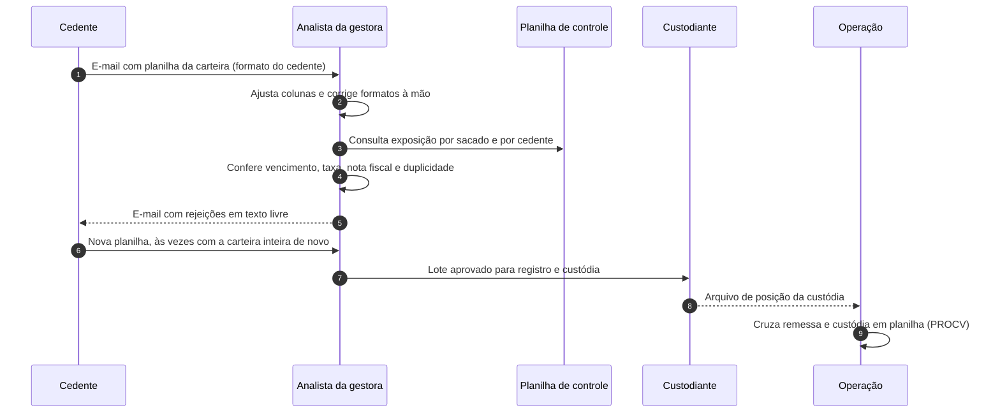
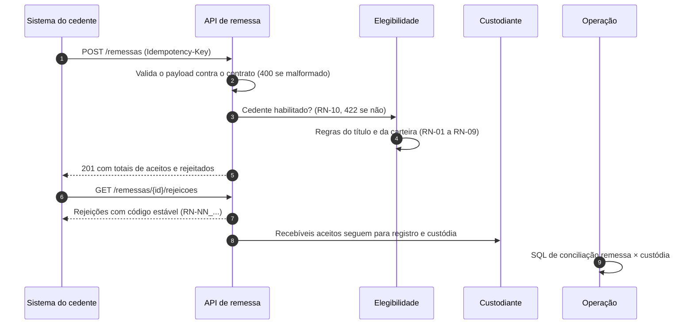

# AS-IS · Como a remessa de recebíveis funciona hoje

> Cenário simulado (PR-01), montado a partir dos regulamentos públicos em `docs/fontes/` e da norma (CVM 175, Anexo II). Nenhum dado real de cedente, sacado ou fundo.

## Atores

| Ator | Papel no processo | No código |
|---|---|---|
| Cedente | Empresa que vende duplicatas ao fundo para antecipar caixa. | `assignor` |
| Analista da gestora | Valida os critérios de elegibilidade antes da cessão. Nos regulamentos da Solis (ZIG e Warehouse, item 6.1), é a gestora quem valida, "previamente à cessão". | `manager` |
| Custodiante | Guarda e controla os recebíveis cedidos e verifica o lastro (art. 38 do Anexo II). | `custodian` |
| Operação | Concilia o que foi cedido com o que está na custódia. | `reconciliation` |

## Fluxo atual

## Pontos de falha

| # | Ponto de falha | Efeito no fundo | Regra ou história que ataca |
|---|---|---|---|
| F-01 | Cada cedente manda a planilha em um formato. | O analista reformata à mão; erro de digitação vira erro de valor. | HU-01 (contrato único) |
| F-02 | Limites de concentração conferidos em planilha separada, com posição do dia anterior. | Risco de desenquadramento: um sacado acima de 4% do PL (BMA 7.24 b) só é percebido no fechamento do mês. | RN-07, RN-08, HU-06 |
| F-03 | Rejeição devolvida em texto livre por e-mail. | O cedente não sabe qual título corrigir nem por quê; reenvia tudo. | HU-09 (rejeições com código estável) |
| F-04 | Reenvio da mesma planilha por falha de e-mail ou dúvida. | Mesmo título analisado e cedido duas vezes. | RN-09, HU-02 (idempotência) |
| F-05 | Título sem nota fiscal aceito "para não perder a operação". | Crédito não performado; risco de duplicata fria. | RN-04 |
| F-06 | Sacado em atraso com o fundo continua recebendo cessões. | Aumenta a exposição a quem já não paga. | RN-05 |
| F-07 | Taxa negociada abaixo do mínimo do regulamento. | Rentabilidade abaixo da meta das cotas seniores. | RN-06 |
| F-08 | Conciliação remessa × custódia por PROCV. | Faltantes, valores divergentes e duplicados descobertos tarde. | HU-11 |
| F-09 | Nenhum registro de quem decidiu o quê e quando. | Auditoria e custodiante não conseguem reconstituir a decisão. | HU-10 |

## TO-BE (o que este projeto propõe)

O ganho esperado:
- a regra é aplicada sempre do mesmo jeito, com a posição da carteira na hora da cessão (F-02);
- o cedente recebe o motivo de cada rejeição em código estável (F-03);
- o reenvio não duplica a cessão (F-04);
- a conciliação vira uma consulta, não uma planilha (F-08).

## Fora do escopo

- Cobrança, recompra e liquidação financeira da cessão.
- Registro em registradora e verificação de lastro por amostragem (arts. 36 e 38): são obrigações do gestor e do custodiante e entram como contexto, não como regra da API (ADR-0006).
- Cadastro e análise de crédito do cedente: a API só consulta se ele está habilitado (RN-10).
